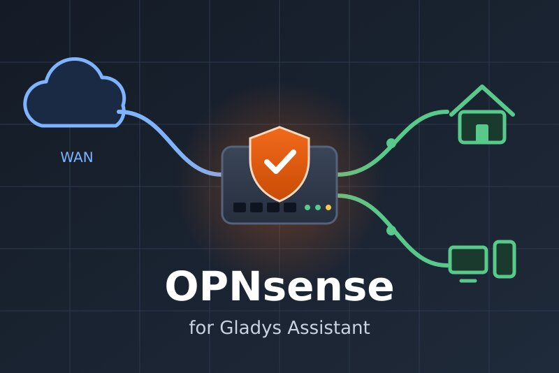
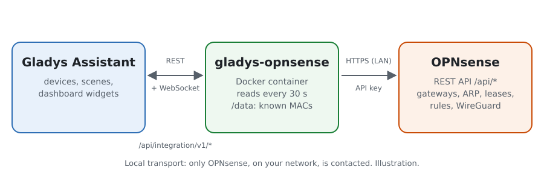
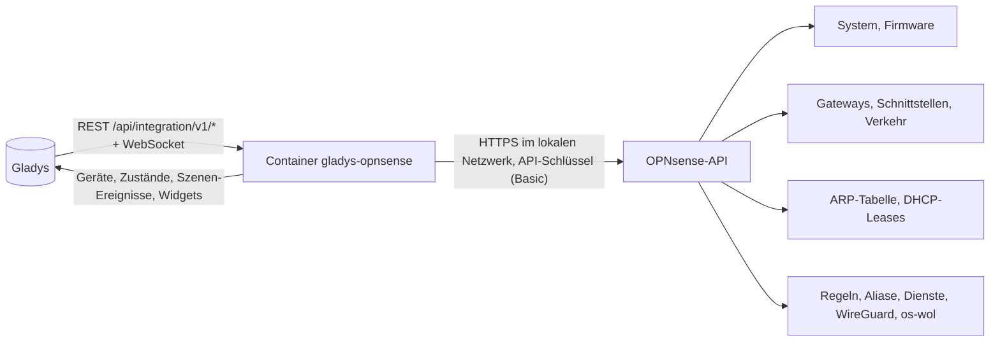
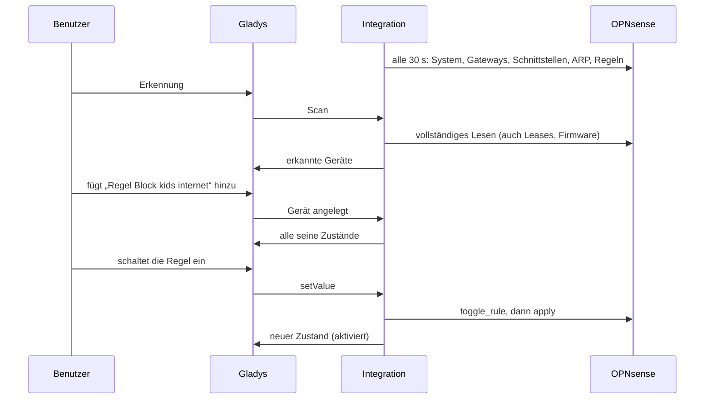
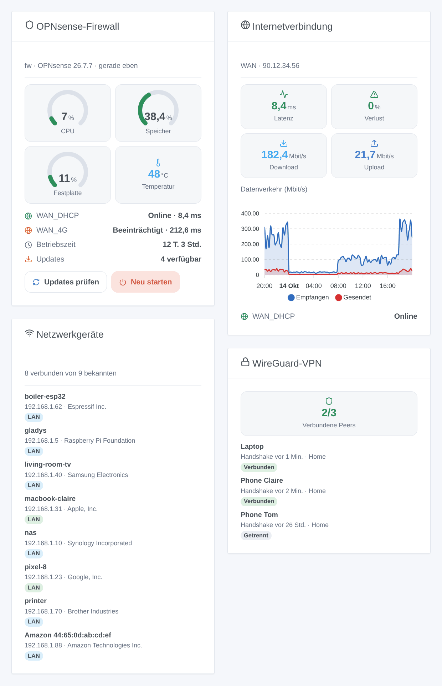

# Gladys OPNsense

[English](README.md) · [Français](README.fr.md) · **Deutsch** · [Español](README.es.md)

[](LICENSE)
[](https://github.com/William-De71/gladys-opnsense/releases)
[](https://github.com/William-De71/gladys-opnsense/actions/workflows/release.yml)
[](https://gladysassistant.com)



Externe Integration für [Gladys Assistant](https://gladysassistant.com) für die **OPNsense**-Firewall: ihr Zustand, ihre Gateways und Schnittstellen, die Geräte in Ihrem Netzwerk, schaltbare Firewall-Regeln, WireGuard, Szenen und Dashboard-Widgets. Alles läuft über die API von OPNsense in Ihrem lokalen Netzwerk, mit einem API-Schlüssel: keine Cloud.

Benutzerdokumentation: [English](docs/en.md) · [Français](docs/fr.md) · [Deutsch](docs/de.md) · [Español](docs/es.md).

> Community-Integration, weder mit Deciso B.V. noch mit dem OPNsense-Projekt verbunden oder von ihnen unterstützt.

## Funktionen

- **Firewall**-Gerät: CPU-, Speicher- und Festplattenauslastung, Temperatur, Betriebszeit, ausstehende Updates, Version, verbundene WireGuard-Peers.
- Ein Gerät pro **Gateway** (Status, Latenz, Paketverlust) und pro **Schnittstelle** (empfangene und gesendete Datenrate, Verbindung, IPv4-Adresse).
- Die **Firewall-Regeln** einer gewählten Kategorie als **Schalter**: das Tablet der Kinder über ein Dashboard oder eine Szene sperren.
- **Anwesenheit** der Geräte in Ihrem Netzwerk, aus der ARP-Tabelle und den DHCP-Leases (Dnsmasq oder Kea), mit einer Abwesenheitsverzögerung.
- **6 Szenen-Auslöser**, **6 Szenen-Aktionen** und **4 Dashboard-Widgets** (siehe unten).
- Vier Sprachen überall: Englisch, Französisch, Deutsch, Spanisch.

## Funktionsweise





Von der Erkennung zum Befehl:



### Transport

`transports: ["local"]`: Die Integration spricht nur mit der API von OPNsense, per HTTPS in Ihrem Netzwerk. Das HTTPS-Zertifikat wird geprüft, wenn Sie „Zertifikat prüfen“ ankreuzen (OPNsense wird mit einem selbstsignierten Zertifikat ausgeliefert). Keine Daten verlassen Ihr Netzwerk; OPNsense selbst kontaktiert bei einer Update-Prüfung seinen Mirror.

## Geräte und Funktionen

| Gerät               | Funktionen (Kategorie / Typ)                                                                                                                                                        |
| ------------------- | ----------------------------------------------------------------------------------------------------------------------------------------------------------------------------------- |
| OPNsense (Firewall) | CPU, Speicher, Festplatte (`level-sensor` %), Temperatur (`device-temperature-sensor`), Betriebszeit (`duration`, Tage), Updates und VPN-Peers (`counter-sensor`), Version (`text`) |
| Gateway             | Status (`text`), Latenz (`duration`, ms), Paketverlust (`level-sensor` %)                                                                                                           |
| Schnittstelle       | Empfangen und gesendet (`datarate`, Mbit/s), Verbindung und IPv4-Adresse (`text`)                                                                                                   |
| Regel               | Aktiviert (`switch` / `binary`, ein Befehl)                                                                                                                                         |
| Netzwerkgerät       | Anwesenheit (`presence-sensor` / `push`, jede Minute 1, solange es da ist, einmal 0, wenn es weg ist)                                                                               |

Die externen IDs beruhen auf stabilen OPNsense-Kennungen: Gateway-Name, Schnittstellen-Kennung, Regel-UUID, MAC-Adresse.

## Szenen-Auslöser, Aktionen und Widgets



**Widgets**: OPNsense-Firewall (Anzeigen, Gateways, Updates, Schaltflächen „Updates prüfen“ und „Neu starten“), Internetverbindung (Latenz, Verlust, Datenraten, Verkehrsdiagramm), Netzwerkgeräte (verbunden, gegangen oder alle), WireGuard-VPN (Peers).

**Auslöser**: Gateway-Status geändert, Gerät gekommen oder gegangen, neues Gerät im Netzwerk (einmal pro MAC-Adresse, in `/data` gespeichert), VPN-Peer verbunden oder nicht, Dienst gestartet oder beendet, Update verfügbar.

**Aktionen**: Status lesen, ein Gerät wecken (Wake-on-LAN durch OPNsense, über VLANs hinweg, Plugin os-wol), eine Adresse in einem Alias hinzufügen oder entfernen, einen Dienst neu starten, nach Updates suchen, neu starten.

Beispiele:

- Wenn `WAN_DHCP` offline geht → Nachricht „Internet ist ausgefallen, 4G übernimmt“.
- Wenn ein neues Gerät im Netzwerk erscheint → Name, Hersteller und IP an den Administrator senden.
- Jeden Abend um 21 Uhr → das Tablet der Kinder zum Alias `kids_block` hinzufügen; um 7 Uhr wieder entfernen.

Eine Änderung durch Gladys selbst (geschaltete Regel, neu gestarteter Dienst, von einer Szene gestartete Prüfung) löst nie eine Szene aus.

## Voraussetzungen

- Gladys Assistant **5.1.0** oder neuer (Widgets und Szenen): Ältere Instanzen können die Integration nicht installieren.
- OPNsense 25.1 oder neuer und ein eigener Benutzer mit API-Schlüssel und den in der [Dokumentation](docs/de.md#voraussetzungen) genannten Rechten.

## Installation

- **Aus dem Store**: Integrationen → OPNsense → Installieren.
- **Über die Repository-URL**: Integrationen → externe Integration → `https://github.com/William-De71/gladys-opnsense`.
- **Entwicklermodus**: `npm start` mit den von Gladys gelieferten Variablen starten (siehe Entwicklung).

## Konfiguration

| Feld                          | Standard    | Bedeutung                                                           |
| ----------------------------- | ----------- | ------------------------------------------------------------------- |
| Adresse von OPNsense          | —           | `https://192.168.1.1`, mit Port, wenn er nicht 443 ist              |
| API-Schlüssel / API-Geheimnis | —           | Die zwei Zeilen von `key.txt` (das Geheimnis ist ein `secret`-Feld) |
| Zertifikat prüfen             | aus         | Mit einem gültigen Zertifikat ankreuzen                             |
| Leseintervall                 | 30 s        | 10 bis 300 s                                                        |
| Angebotene Netzwerkgeräte     | mit Namen   | mit Namen, alle, keine                                              |
| Abwesenheitsverzögerung       | 5 Min.      | 1 bis 60 Min.                                                       |
| Kategorie der Regeln          | `gladys`    | Leer: kein Regel-Schalter                                           |
| Sprache der Texte             | automatisch | Namen, Zustände und Szenen-Zusammenfassungen                        |

## Verwendung

1. Konfiguration ausfüllen, dann **Verbindung testen** klicken.
2. **Erkennung**, dann die gewünschte Firewall, Gateways, Schnittstellen, Regeln und Netzwerkgeräte hinzufügen.
3. Die Widgets einem Dashboard hinzufügen und Szenen mit den Auslösern und Aktionen bauen.

## Entwicklung

```bash
npm install
npm test                       # node --test, berührt nie das Netzwerk
npm run lint                   # ESLint
npm run format:check           # Prettier
npx github:GladysAssistant/integration-store . --skip-image-check
scripts/build-cover.sh         # cover.jpg aus docs/assets/cover.svg
docs/illustrations/render.sh   # docs/assets/widgets.<Sprache>.png
```

Lokal liest das SDK `GLADYS_HOST_API_URL`, `GLADYS_INTEGRATION_TOKEN` und `GLADYS_INTEGRATION_SELECTOR` (von Gladys im Entwicklermodus geliefert). `DEBUG=gladys-integration-sdk` zeigt die Logs des SDK.

Die Tests decken den OPNsense-Client (Fehler, Authentifizierung, CPU-Ereignisstrom auf einem lokalen Server), das Lesen der Antworten, die Übergänge und die Anwesenheit, die Geräte (die vom Erkennungsbildschirm verlangten Felder), die Widgets (`validateWidgetContent`), die Szenen-Ereignisse und -Ausgaben, das Manifest, die vier Sprachen, das Release-Skript und die ganze Integration gegen das Fake-Gladys des SDK und eine Fake-OPNsense ab. `test/structure.test.js` friert alle beim Benutzer gespeicherten Schlüssel ein.

## Release-Prozess


Jeder Merge auf `main` startet die CI und berechnet dann die Version aus den [Conventional Commits](https://www.conventionalcommits.org/) seit dem letzten Tag: `feat` → Minor, `fix` / `perf` → Patch, `!` oder `BREAKING CHANGE` → Major (ein Minor unter 1.0.0); `docs`, `chore`, `ci`, `test`, `style`, `refactor`, `build` allein veröffentlichen nichts. Der Changelog-Abschnitt wird erzeugt, der Tag gepusht, das Multi-Architektur-Image gebaut, dann erhält `main` den Release-Commit, das GitHub Release wird angelegt und ein letzter Job prüft das öffentliche Image, den Store-Validator und das Topic.

- Der Titel des Pull Requests wird zum Squash-Commit und dann zur Changelog-Zeile: auf Englisch, für den Benutzer schreiben (`pr-title.yml` prüft ihn). `CHANGELOG.md` nie von Hand bearbeiten.
- 1.0.0 ist eine Entscheidung: Actions → Release → Run workflow mit `release-as: 1.0.0`. `dry-run` zeigt Version und Notizen, ohne zu veröffentlichen.
- **Geschützter Branch**: Das Release pusht seinen Commit mit `GITHUB_TOKEN` auf `main`. Mit einem Ruleset auf `main` GitHub Actions zu dessen Bypass-Liste hinzufügen (oder über eine GitHub App pushen), sonst schlägt der Veröffentlichungs-Job mit Anweisungen fehl.
- Nach dem ersten Release das `ghcr.io`-Paket öffentlich machen (Package settings → Change visibility), sonst kann Gladys es nicht laden.

## Fehlerbehebung

Siehe [docs/de.md](docs/de.md#fehlerbehebung). Probleme mit den Versionen von Gladys, der Integration und OPNsense sowie den Logs (`DEBUG=gladys-integration-sdk`) melden.

## Mitwirken

Issues und Pull Requests sind willkommen. Vor einem Pull Request `npm run format:check && npm run lint && npm test` ausführen und alle externen IDs und gespeicherten Schlüssel unverändert lassen (siehe [CLAUDE.md](CLAUDE.md)).

## Sicherheit

Siehe [SECURITY.md](SECURITY.md): Schwachstellen vertraulich melden. Das API-Geheimnis ist ein `secret`-Feld, nie in Logs oder einer URL. Geben Sie dem API-Benutzer nur die nötigen Rechte.

## Kommende Screenshots

Die Bilder oben sind Illustrationen, keine Screenshots. Echte Screenshots kommen nach `docs/assets/screenshots/` (PNG, 1280 × 800): `configuration.png`, `discovery.png`, `devices.png`, `scene.png`.

## Lizenz

[Apache License 2.0](LICENSE) — siehe auch [NOTICE](NOTICE). OPNsense ist eine eingetragene Marke von Deciso B.V.; diese Community-Integration ist nicht mit ihr verbunden. Dank an die Dokumentation und das SDK von Gladys sowie an die API-Dokumentation von OPNsense.
