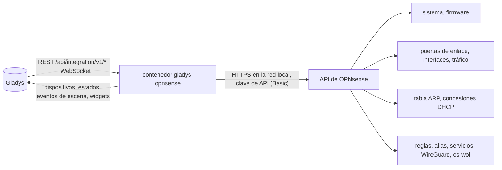
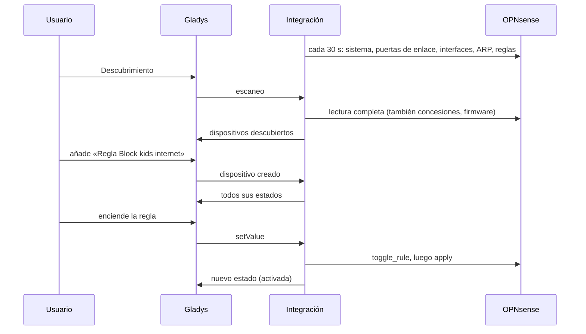
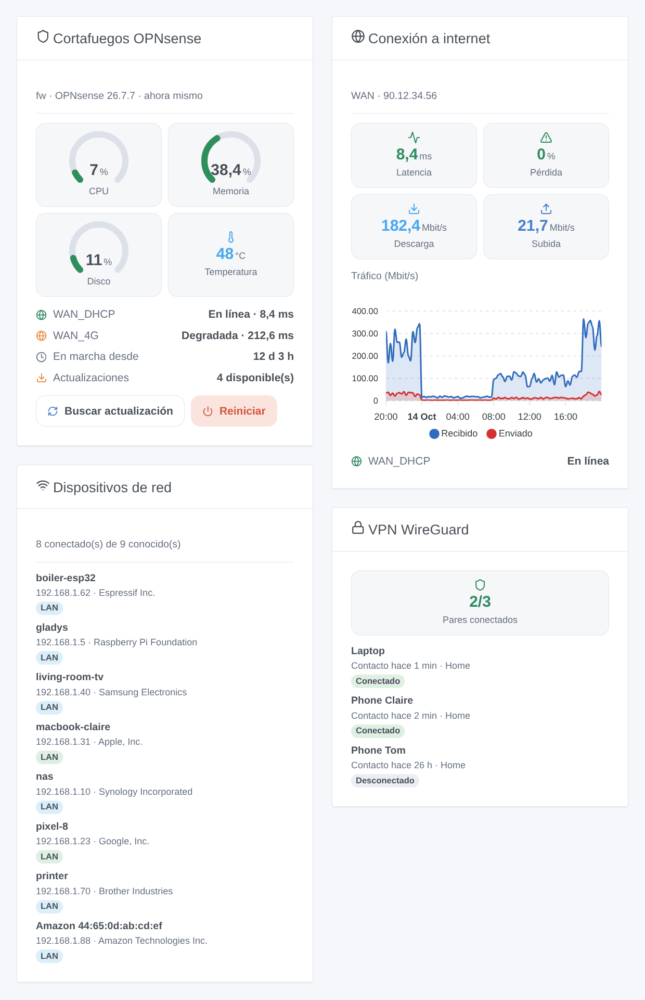

# Gladys OPNsense

[English](README.md) · [Français](README.fr.md) · [Deutsch](README.de.md) · **Español**

[](LICENSE)
[](https://github.com/William-De71/gladys-opnsense/releases)
[](https://github.com/William-De71/gladys-opnsense/actions/workflows/release.yml)
[](https://gladysassistant.com)


Integración externa de [Gladys Assistant](https://gladysassistant.com) para el cortafuegos **OPNsense**: su estado, sus puertas de enlace e interfaces, los dispositivos presentes en su red, reglas de cortafuegos conmutables, WireGuard, escenas y widgets. Todo pasa por la API de OPNsense en su red local, con una clave de API: sin nube.

Documentación de usuario: [English](docs/en.md) · [Français](docs/fr.md) · [Deutsch](docs/de.md) · [Español](docs/es.md).

> Integración comunitaria, sin relación con Deciso B.V. ni con el proyecto OPNsense, ni respaldada por ellos.

## Funciones

- Dispositivo **cortafuegos**: uso de CPU, memoria y disco, temperatura, tiempo en marcha, actualizaciones pendientes, versión, pares WireGuard conectados.
- Un dispositivo por **puerta de enlace** (estado, latencia, pérdida de paquetes) y por **interfaz** (velocidades recibida y enviada, enlace, dirección IPv4).
- Las **reglas del cortafuegos** de una categoría elegida, como **interruptores**: bloquear la tableta de los niños desde un panel o una escena.
- **Presencia** de los dispositivos de su red, a partir de la tabla ARP y de las concesiones DHCP (Dnsmasq o Kea), con un retardo de ausencia.
- **6 disparadores de escena**, **6 acciones de escena** y **4 widgets de panel** (abajo).
- Cuatro idiomas en todas partes: inglés, francés, alemán, español.

## Funcionamiento




Del descubrimiento al comando:



### Transporte

`transports: ["local"]`: la integración solo habla con la API de OPNsense, por HTTPS en su red. El certificado HTTPS se verifica si marca «Verificar el certificado» (OPNsense viene con un certificado autofirmado). Ningún dato sale de su red; el propio OPNsense contacta con su réplica de actualizaciones durante una búsqueda.

## Dispositivos y funciones

| Dispositivo            | Funciones (categoría / tipo)                                                                                                                                                             |
| ---------------------- | ---------------------------------------------------------------------------------------------------------------------------------------------------------------------------------------- |
| OPNsense (cortafuegos) | CPU, memoria, disco (`level-sensor` %), temperatura (`device-temperature-sensor`), tiempo en marcha (`duration`, días), actualizaciones y pares VPN (`counter-sensor`), versión (`text`) |
| Puerta de enlace       | Estado (`text`), latencia (`duration`, ms), pérdida de paquetes (`level-sensor` %)                                                                                                       |
| Interfaz               | Recibido y enviado (`datarate`, Mbit/s), enlace y dirección IPv4 (`text`)                                                                                                                |
| Regla                  | Activada (`switch` / `binary`, un comando)                                                                                                                                               |
| Dispositivo de red     | Presencia (`presence-sensor` / `push`, 1 cada minuto mientras está, 0 una vez cuando se va)                                                                                              |

Los identificadores externos se basan en identificadores estables de OPNsense: nombre de la puerta de enlace, identificador de la interfaz, UUID de la regla, dirección MAC.

## Disparadores, acciones de escena y widgets



**Widgets**: Cortafuegos OPNsense (indicadores, puertas de enlace, actualizaciones, botones «buscar actualizaciones» y «reiniciar»), Conexión a internet (latencia, pérdida, velocidades, gráfico del tráfico), Dispositivos de red (conectados, idos o todos), VPN WireGuard (pares).

**Disparadores**: estado de puerta de enlace cambiado, dispositivo llegó o se fue, nuevo dispositivo en la red (una vez por dirección MAC, recordada en `/data`), par VPN conectado o no, servicio iniciado o detenido, actualización disponible.

**Acciones**: leer el estado, despertar un dispositivo (Wake-on-LAN por OPNsense, a través de las VLAN, plugin os-wol), añadir o quitar una dirección de un alias, reiniciar un servicio, buscar actualizaciones, reiniciar.

Ejemplos:

- Cuando `WAN_DHCP` pasa a sin conexión → mensaje «Internet ha caído, el 4G toma el relevo».
- Cuando aparece un nuevo dispositivo en la red → enviar su nombre, fabricante e IP al administrador.
- Cada noche a las 21:00 → añadir la tableta de los niños al alias `kids_block`; quitarla a las 7:00.

Un cambio hecho por la propia Gladys (regla conmutada, servicio reiniciado, búsqueda lanzada por una escena) nunca dispara una escena.

## Requisitos

- Gladys Assistant **5.3.0** o posterior (widgets y escenas, palabras clave del catálogo de Gladys 5.3): las instancias anteriores no pueden instalar la integración.
- OPNsense 25.1 o posterior, y un usuario dedicado con clave de API y los privilegios indicados en la [documentación](docs/es.md#requisitos-previos).

## Instalación

- **Desde la tienda**: Integraciones → OPNsense → Instalar.
- **Desde la URL del repositorio**: Integraciones → integración externa → `https://github.com/William-De71/gladys-opnsense`.
- **Modo desarrollador**: ejecute `npm start` con las variables que da Gladys (ver Desarrollo).

## Configuración

| Campo                         | Por defecto | Significado                                                   |
| ----------------------------- | ----------- | ------------------------------------------------------------- |
| Dirección de OPNsense         | —           | `https://192.168.1.1`, con el puerto si no es el 443          |
| Clave / secreto de la API     | —           | Las dos líneas de `key.txt` (el secreto es un campo `secret`) |
| Verificar el certificado      | no          | Márquelo con un certificado válido                            |
| Intervalo de lectura          | 30 s        | De 10 a 300 s                                                 |
| Dispositivos de red ofrecidos | con nombre  | con nombre, todos, ninguno                                    |
| Retardo de ausencia           | 5 min       | De 1 a 60 min                                                 |
| Categoría de las reglas       | `gladys`    | Vacío: ningún interruptor de regla                            |
| Idioma de los textos          | automático  | Nombres, estados y resúmenes de escenas                       |

## Uso

1. Rellene la configuración y pulse **Probar la conexión**.
2. **Descubrimiento**, luego añada el cortafuegos, las puertas de enlace, las interfaces, las reglas y los dispositivos de red que quiera.
3. Añada los widgets a un panel y cree escenas con los disparadores y acciones.

## Desarrollo

```bash
npm install
npm test                       # node --test, nunca toca la red
npm run lint                   # ESLint
npm run format:check           # Prettier
npx github:GladysAssistant/integration-store . --skip-image-check
scripts/build-cover.sh         # cover.jpg desde docs/assets/cover.svg
docs/illustrations/render.sh   # docs/assets/widgets.<idioma>.png
```

En local, el SDK lee `GLADYS_HOST_API_URL`, `GLADYS_INTEGRATION_TOKEN` y `GLADYS_INTEGRATION_SELECTOR` (que da Gladys en modo desarrollador). `DEBUG=gladys-integration-sdk` muestra los registros del SDK.

Las pruebas cubren el cliente de OPNsense (errores, autenticación, flujo de CPU en un servidor local), la lectura de las respuestas, las transiciones y la presencia, los dispositivos (los campos que exige la pantalla de descubrimiento), los widgets (`validateWidgetContent`), los eventos y salidas de escena, el manifiesto, los cuatro idiomas, el script de release y la integración completa frente al Gladys falso del SDK y un OPNsense falso. `test/structure.test.js` congela todas las claves que guardan los usuarios.

## Proceso de release


Cada fusión en `main` lanza la CI y luego calcula la versión a partir de los [Conventional Commits](https://www.conventionalcommits.org/) desde la última etiqueta: `feat` → menor, `fix` / `perf` → parche, `!` o `BREAKING CHANGE` → mayor (una menor por debajo de 1.0.0); `docs`, `chore`, `ci`, `test`, `style`, `refactor`, `build` solos no publican nada. Se genera la sección del changelog, se sube la etiqueta, se construye la imagen multiarquitectura, luego `main` recibe el commit de release, se crea la GitHub Release y un último job comprueba la imagen pública, el validador de la tienda y el topic.

- El título de la pull request se convierte en el commit squash y luego en la línea del changelog: escríbalo en inglés, para el usuario (`pr-title.yml` lo comprueba). No edite nunca `CHANGELOG.md` a mano.
- La 1.0.0 es una decisión: Actions → Release → Run workflow con `release-as: 1.0.0`. `dry-run` muestra la versión y las notas sin publicar.
- **Rama protegida**: la release sube su commit a `main` con `GITHUB_TOKEN`. Con un ruleset en `main`, añada GitHub Actions a su lista de excepciones (o suba mediante una GitHub App); si no, el job de publicación falla con instrucciones.
- Tras la primera release, haga público el paquete `ghcr.io` (Package settings → Change visibility), o Gladys no podrá descargarlo.

## Solución de problemas

Ver [docs/es.md](docs/es.md#solución-de-problemas). Informe de los problemas con las versiones de Gladys, de la integración y de OPNsense, y los registros (`DEBUG=gladys-integration-sdk`).

## Contribuir

Issues y pull requests son bienvenidas. Ejecute `npm run format:check && npm run lint && npm test` antes de abrir una pull request, y mantenga sin cambios todos los identificadores externos y claves guardadas (ver [CLAUDE.md](CLAUDE.md)).

## Seguridad

Ver [SECURITY.md](SECURITY.md): informe de las vulnerabilidades en privado. El secreto de la API es un campo `secret`, nunca en los registros ni en una URL. Dé al usuario de la API solo los privilegios necesarios.

## Capturas por venir

Las imágenes de arriba son ilustraciones, no capturas de pantalla. Las capturas reales irán en `docs/assets/screenshots/` (PNG, 1280 × 800): `configuration.png`, `discovery.png`, `devices.png`, `scene.png`.

## Licencia

[Apache License 2.0](LICENSE) — ver también [NOTICE](NOTICE). OPNsense es una marca registrada de Deciso B.V.; esta integración comunitaria no está vinculada a ella. Gracias a la documentación y al SDK de Gladys, y a la documentación de la API de OPNsense.
