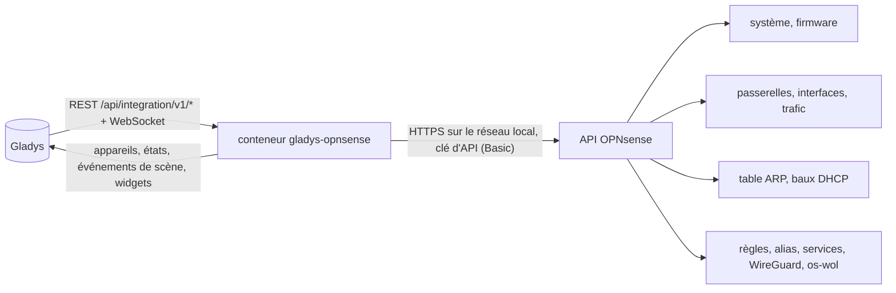
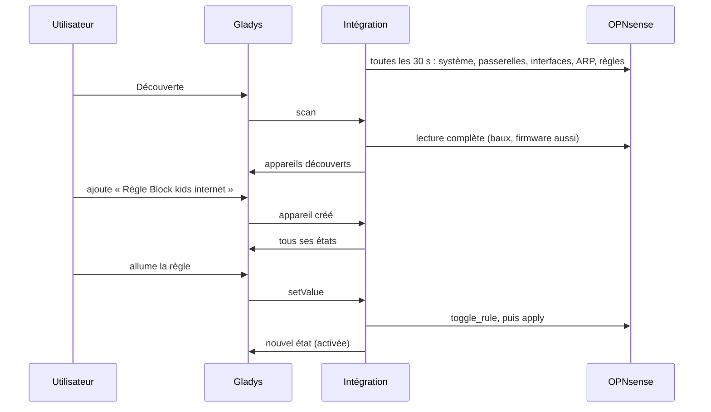
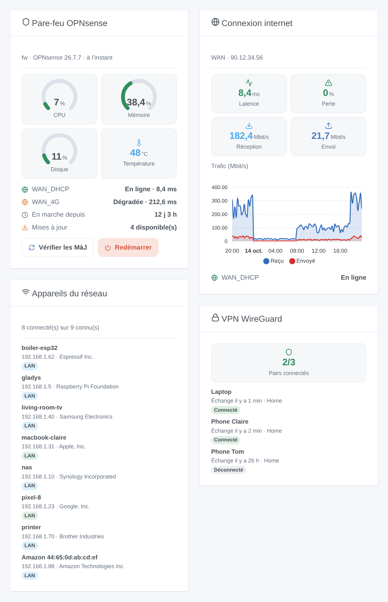

# Gladys OPNsense

[English](README.md) · **Français** · [Deutsch](README.de.md) · [Español](README.es.md)

[](LICENSE)
[](https://github.com/William-De71/gladys-opnsense/releases)
[](https://github.com/William-De71/gladys-opnsense/actions/workflows/release.yml)
[](https://gladysassistant.com)


Intégration externe [Gladys Assistant](https://gladysassistant.com) pour le pare-feu **OPNsense** : sa santé, ses passerelles et interfaces, les appareils présents sur votre réseau, des règles de pare-feu à basculer, WireGuard, des scènes et des widgets. Tout passe par l'API d'OPNsense sur votre réseau local, avec une clé d'API : aucun cloud.

Documentation utilisateur : [English](docs/en.md) · [Français](docs/fr.md) · [Deutsch](docs/de.md) · [Español](docs/es.md).

> Intégration communautaire, sans lien avec Deciso B.V. ni le projet OPNsense, ni approuvée par eux.

## Fonctionnalités

- Appareil **pare-feu** : utilisation CPU, mémoire et disque, température, temps de fonctionnement, mises à jour en attente, version, pairs WireGuard connectés.
- Un appareil par **passerelle** (état, latence, perte de paquets) et par **interface** (débits reçu et envoyé, lien, adresse IPv4).
- Les **règles de pare-feu** d'une catégorie choisie, en **interrupteurs** : bloquer la tablette des enfants depuis un tableau de bord ou une scène.
- La **présence** des appareils de votre réseau, d'après la table ARP et les baux DHCP (Dnsmasq ou Kea), avec un délai d'absence.
- **6 déclencheurs de scène**, **6 actions de scène** et **4 widgets** (ci-dessous).
- Quatre langues partout : anglais, français, allemand, espagnol.

## Fonctionnement




De la découverte à la commande :



### Transport

`transports: ["local"]` : l'intégration ne parle qu'à l'API d'OPNsense, en HTTPS sur votre réseau. Le certificat HTTPS est vérifié si vous cochez « Vérifier le certificat » (OPNsense est livré avec un certificat auto-signé). Aucune donnée ne quitte votre réseau ; OPNsense lui-même contacte son miroir de mises à jour lors d'une recherche.

## Appareils et fonctionnalités

| Appareil            | Fonctionnalités (catégorie / type)                                                                                                                                                              |
| ------------------- | ----------------------------------------------------------------------------------------------------------------------------------------------------------------------------------------------- |
| OPNsense (pare-feu) | CPU, mémoire, disque (`level-sensor` %), température (`device-temperature-sensor`), temps de fonctionnement (`duration`, jours), mises à jour et pairs VPN (`counter-sensor`), version (`text`) |
| Passerelle          | État (`text`), latence (`duration`, ms), perte de paquets (`level-sensor` %)                                                                                                                    |
| Interface           | Reçu et envoyé (`datarate`, Mbit/s), lien et adresse IPv4 (`text`)                                                                                                                              |
| Règle               | Activée (`switch` / `binary`, une commande)                                                                                                                                                     |
| Appareil du réseau  | Présence (`presence-sensor` / `push`, 1 chaque minute tant qu'il est là, 0 une fois parti)                                                                                                      |

Les identifiants externes reposent sur des identifiants stables d'OPNsense : nom de passerelle, identifiant d'interface, UUID de règle, adresse MAC.

## Déclencheurs, actions de scène et widgets



**Widgets** : Pare-feu OPNsense (jauges, passerelles, mises à jour, boutons « vérifier les mises à jour » et « redémarrer »), Connexion internet (latence, perte, débits, graphique du trafic), Appareils du réseau (connectés, partis ou tous), VPN WireGuard (pairs).

**Déclencheurs** : état de passerelle changé, appareil arrivé ou parti, nouvel appareil sur le réseau (une fois par adresse MAC, mémorisée dans `/data`), pair VPN connecté ou non, service démarré ou arrêté, mise à jour disponible.

**Actions** : lire l'état, réveiller un appareil (Wake-on-LAN par OPNsense, à travers les VLAN, plugin os-wol), ajouter ou retirer une adresse d'un alias, redémarrer un service, rechercher les mises à jour, redémarrer.

Exemples :

- Quand `WAN_DHCP` passe hors ligne → message « Internet est coupé, la 4G prend le relais ».
- Quand un nouvel appareil apparaît sur le réseau → envoyer son nom, son fabricant et son IP à l'administrateur.
- Chaque soir à 21 h → ajouter la tablette des enfants à l'alias `kids_block` ; la retirer à 7 h.

Un changement fait par Gladys elle-même (règle basculée, service redémarré, recherche lancée par une scène) ne déclenche jamais de scène.

## Prérequis

- Gladys Assistant **5.3.0** ou plus récent (widgets et scènes, mots-clés du catalogue de Gladys 5.3) : les instances plus anciennes ne peuvent pas installer l'intégration.
- OPNsense 25.1 ou plus récent, et un utilisateur dédié avec une clé d'API et les droits listés dans la [documentation](docs/fr.md#prérequis).

## Installation

- **Depuis le store** : Intégrations → OPNsense → Installer.
- **Depuis l'URL du dépôt** : Intégrations → intégration externe → `https://github.com/William-De71/gladys-opnsense`.
- **Mode développeur** : lancez `npm start` avec les variables fournies par Gladys (voir Développement).

## Configuration

| Champ                        | Défaut      | Rôle                                                           |
| ---------------------------- | ----------- | -------------------------------------------------------------- |
| Adresse d'OPNsense           | —           | `https://192.168.1.1`, avec le port s'il n'est pas 443         |
| Clé d'API / secret de l'API  | —           | Les deux lignes de `key.txt` (le secret est un champ `secret`) |
| Vérifier le certificat       | non         | À cocher avec un certificat valide                             |
| Intervalle de lecture        | 30 s        | De 10 à 300 s                                                  |
| Appareils du réseau proposés | avec un nom | avec un nom, tous, aucun                                       |
| Délai d'absence              | 5 min       | De 1 à 60 min                                                  |
| Catégorie des règles         | `gladys`    | Vide : aucun interrupteur de règle                             |
| Langue des textes            | automatique | Noms, états et résumés de scènes                               |

## Utilisation

1. Remplissez la configuration, puis cliquez sur **Tester la connexion**.
2. **Découverte**, puis ajoutez le pare-feu, les passerelles, les interfaces, les règles et les appareils du réseau voulus.
3. Ajoutez les widgets à un tableau de bord, et construisez des scènes avec les déclencheurs et actions.

## Développement

```bash
npm install
npm test                       # node --test, ne touche jamais le réseau
npm run lint                   # ESLint
npm run format:check           # Prettier
npx github:GladysAssistant/integration-store . --skip-image-check
scripts/build-cover.sh         # cover.jpg depuis docs/assets/cover.svg
docs/illustrations/render.sh   # docs/assets/widgets.<langue>.png
```

En local, le SDK lit `GLADYS_HOST_API_URL`, `GLADYS_INTEGRATION_TOKEN` et `GLADYS_INTEGRATION_SELECTOR` (fournies par Gladys en mode développeur). `DEBUG=gladys-integration-sdk` affiche les logs du SDK.

Les tests couvrent le client OPNsense (erreurs, authentification, flux CPU sur un serveur local), la lecture des réponses, les transitions et la présence, les appareils (les champs exigés par l'écran de découverte), les widgets (`validateWidgetContent`), les événements et sorties de scène, le manifeste, les quatre langues, le script de release, et l'intégration entière face au faux Gladys du SDK et à un faux OPNsense. `test/structure.test.js` fige toutes les clés stockées chez l'utilisateur.

## Processus de release


Chaque fusion sur `main` lance la CI, puis calcule la version d'après les [Conventional Commits](https://www.conventionalcommits.org/) depuis le dernier tag : `feat` → mineure, `fix` / `perf` → correctif, `!` ou `BREAKING CHANGE` → majeure (une mineure tant que la version est sous 1.0.0) ; `docs`, `chore`, `ci`, `test`, `style`, `refactor`, `build` seuls ne publient rien. La section du changelog est générée, le tag poussé, l'image multi-architecture construite, puis `main` reçoit le commit de release, la GitHub Release est créée et un dernier job vérifie l'image publique, le validateur du store et le topic.

- Le titre de la pull request devient le commit squash, puis la ligne du changelog : écrivez-le en anglais, pour l'utilisateur (`pr-title.yml` le vérifie). Ne modifiez jamais `CHANGELOG.md` à la main.
- La 1.0.0 est une décision : Actions → Release → Run workflow avec `release-as: 1.0.0`. `dry-run` affiche la version et les notes sans rien publier.
- **Branche protégée** : la release pousse son commit sur `main` avec `GITHUB_TOKEN`. Avec un ruleset sur `main`, ajoutez GitHub Actions à sa liste de contournement (ou poussez par une GitHub App), sinon le job de publication échoue avec des instructions.
- Après la première release, rendez public le package `ghcr.io` (Package settings → Change visibility), sinon Gladys ne peut pas le télécharger.

## Dépannage

Voir [docs/fr.md](docs/fr.md#dépannage). Signalez les problèmes avec les versions de Gladys, de l'intégration et d'OPNsense, et les logs (`DEBUG=gladys-integration-sdk`).

## Contribuer

Issues et pull requests sont les bienvenues. Lancez `npm run format:check && npm run lint && npm test` avant d'ouvrir une pull request, et gardez inchangés tous les identifiants externes et clés stockées (voir [CLAUDE.md](CLAUDE.md)).

## Sécurité

Voir [SECURITY.md](SECURITY.md) : signalez les vulnérabilités en privé. Le secret de l'API est un champ `secret`, jamais écrit dans les logs ni dans une URL. Ne donnez à l'utilisateur de l'API que les droits nécessaires.

## Captures à venir

Les images ci-dessus sont des illustrations, pas des captures d'écran. Les vraies captures iront dans `docs/assets/screenshots/` (PNG, 1280 × 800) : `configuration.png`, `discovery.png`, `devices.png`, `scene.png`.

## Licence

[Apache License 2.0](LICENSE) — voir aussi [NOTICE](NOTICE). OPNsense est une marque déposée de Deciso B.V. ; cette intégration communautaire n'y est pas liée. Merci à la documentation et au SDK de Gladys, ainsi qu'à la documentation de l'API d'OPNsense.
