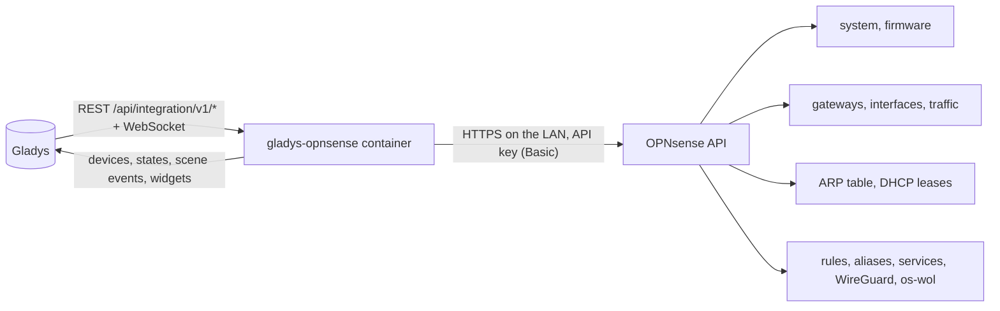
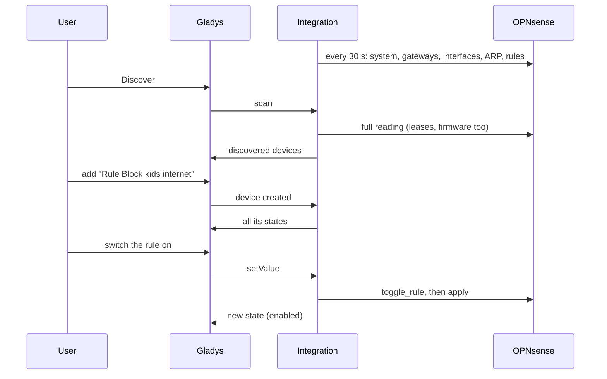
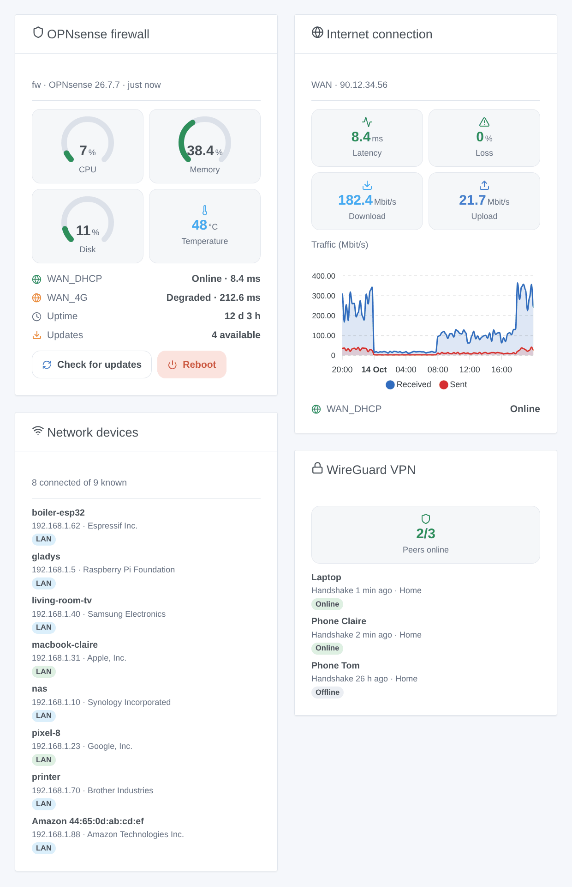

# Gladys OPNsense

**English** · [Français](README.fr.md) · [Deutsch](README.de.md) · [Español](README.es.md)

[](LICENSE)
[](https://github.com/William-De71/gladys-opnsense/releases)
[](https://github.com/William-De71/gladys-opnsense/actions/workflows/release.yml)
[](https://gladysassistant.com)


[Gladys Assistant](https://gladysassistant.com) external integration for the **OPNsense** firewall: its health, its gateways and interfaces, the devices present on your network, firewall rules you can switch, WireGuard, scenes and dashboard widgets. Everything goes through the OPNsense API on your local network, with an API key: no cloud.

User documentation: [English](docs/en.md) · [Français](docs/fr.md) · [Deutsch](docs/de.md) · [Español](docs/es.md).

> Community integration, not affiliated with nor endorsed by Deciso B.V. or the OPNsense project.

## Features

- **Firewall** device: CPU, memory and disk usage, temperature, uptime, pending updates, version, WireGuard peers online.
- A device per **gateway** (status, latency, packet loss) and per **interface** (received and sent rates, link, IPv4 address).
- **Firewall rules** of a chosen category as **switches**: block the kids' tablet from a dashboard or a scene.
- **Presence** of the devices of your network, from the ARP table and the DHCP leases (Dnsmasq or Kea), with an absence delay.
- **6 scene triggers**, **6 scene actions** and **4 dashboard widgets** (below).
- Four languages everywhere: English, French, German, Spanish.

## How it works




From the scan to a command:



### Transport

`transports: ["local"]`: the integration only talks to the OPNsense API, over HTTPS on your network. The HTTPS certificate is checked when you tick "Verify the certificate" (a self-signed certificate is the OPNsense default). No data leaves your network; OPNsense itself contacts its update mirror during an update check.

## Devices and features

| Device              | Features (category / type)                                                                                                                                             |
| ------------------- | ---------------------------------------------------------------------------------------------------------------------------------------------------------------------- |
| OPNsense (firewall) | CPU, memory, disk (`level-sensor` %), temperature (`device-temperature-sensor`), uptime (`duration`, days), updates and VPN peers (`counter-sensor`), version (`text`) |
| Gateway             | Status (`text`), latency (`duration`, ms), packet loss (`level-sensor` %)                                                                                              |
| Interface           | Received and sent (`datarate`, Mbit/s), link and IPv4 address (`text`)                                                                                                 |
| Rule                | Enabled (`switch` / `binary`, a command)                                                                                                                               |
| Network device      | Presence (`presence-sensor` / `push`, 1 every minute while present, 0 once gone)                                                                                       |

External ids rest on stable OPNsense identifiers: gateway name, interface identifier, rule UUID, MAC address.

## Scene triggers, actions and widgets



**Widgets**: OPNsense firewall (gauges, gateways, updates, "check for updates" and "reboot" buttons), Internet connection (latency, loss, rates, traffic chart), Network devices (connected, gone, all or new), WireGuard VPN (peers).

**Triggers**: gateway status changed, device arrived or left, new device on the network (once per MAC address, remembered in `/data`), VPN peer connected or not, service started or stopped, update available.

**Actions**: read the status, wake a device (Wake-on-LAN by OPNsense, across VLANs, os-wol plugin), add or remove an address in an alias, restart a service, check for updates, reboot.

Examples:

- When `WAN_DHCP` goes offline → message "Internet is down, the 4G link takes over".
- When a new device appears on the network → send its name, maker and IP to the administrator.
- Every evening at 21:00 → add the kids' tablet to the alias `kids_block`; remove it at 7:00.

A change made by Gladys itself (a rule switched, a service restarted, a check run by a scene) never fires a trigger.

## Requirements

- Gladys Assistant **5.1.0** or later (widgets and scenes): older instances cannot install the integration.
- OPNsense 25.1 or later, and a dedicated user with an API key and the privileges listed in the [documentation](docs/en.md#prerequisites).

## Installation

- **From the store**: Integrations → OPNsense → Install.
- **From the repository URL**: Integrations → external integration → `https://github.com/William-De71/gladys-opnsense`.
- **Developer mode**: run `npm start` with the variables given by Gladys (see Development).

## Configuration

| Field                   | Default     | Meaning                                                     |
| ----------------------- | ----------- | ----------------------------------------------------------- |
| OPNsense address        | —           | `https://192.168.1.1`, with the port if it is not 443       |
| API key / API secret    | —           | The two lines of `key.txt` (the secret is a `secret` field) |
| Verify the certificate  | off         | Tick it with a valid certificate                            |
| Reading interval        | 30 s        | 10 to 300 s                                                 |
| Network devices offered | with a name | with a name, all, none                                      |
| Absence delay           | 5 min       | 1 to 60 min                                                 |
| Category of the rules   | `gladys`    | Empty: no rule switch                                       |
| Language of the texts   | automatic   | Names, states and scene summaries                           |

## Usage

1. Fill in the configuration, then click **Test the connection**.
2. **Discover**, then add the firewall, the gateways, the interfaces, the rules and the network devices you want.
3. Add the widgets to a dashboard, and build scenes with the triggers and actions.

## Development

```bash
npm install
npm test                       # node --test, never touches the network
npm run lint                   # ESLint
npm run format:check           # Prettier
npx github:GladysAssistant/integration-store . --skip-image-check
scripts/build-cover.sh         # cover.jpg from docs/assets/cover.svg
docs/illustrations/render.sh   # docs/assets/widgets.<lang>.png
```

Locally, the SDK reads `GLADYS_HOST_API_URL`, `GLADYS_INTEGRATION_TOKEN` and `GLADYS_INTEGRATION_SELECTOR` (given by Gladys in developer mode). `DEBUG=gladys-integration-sdk` shows the SDK logs.

The tests cover the OPNsense client (errors, authentication, the CPU event stream on a local server), the reading of the answers, the transitions and the presence, the devices (the fields the Discovery screen requires), the widgets (`validateWidgetContent`), the scene events and outputs, the manifest, the four languages, the release script, and the whole integration against the fake Gladys of the SDK and a fake OPNsense. `test/structure.test.js` freezes every key users store.

## Release process


Every merge on `main` runs the CI, then computes the version from the [Conventional Commits](https://www.conventionalcommits.org/) since the last tag: `feat` → minor, `fix` / `perf` → patch, `!` or `BREAKING CHANGE` → major (a minor below 1.0.0); `docs`, `chore`, `ci`, `test`, `style`, `refactor`, `build` alone publish nothing. The changelog section is generated, the tag pushed, the multi-architecture image built, then `main` receives the release commit, the GitHub Release is created and a last job checks the public image, the store validator and the topic.

- The pull request title becomes the squash commit, then the changelog line: write it in English, for the user (`pr-title.yml` checks it). Never edit `CHANGELOG.md` by hand.
- 1.0.0 is a decision: Actions → Release → Run workflow with `release-as: 1.0.0`. `dry-run` shows the version and the notes without publishing.
- **Protected branch**: the release pushes its commit to `main` with `GITHUB_TOKEN`. With a ruleset on `main`, add GitHub Actions to its bypass list (or push through a GitHub App), otherwise the publish job fails with instructions.
- After the first release, make the `ghcr.io` package public (Package settings → Change visibility), or Gladys cannot pull it.

## Troubleshooting

See [docs/en.md](docs/en.md#troubleshooting). Report issues with the versions of Gladys, of the integration and of OPNsense, and the logs (`DEBUG=gladys-integration-sdk`).

## Contributing

Issues and pull requests are welcome. Run `npm run format:check && npm run lint && npm test` before opening a pull request, and keep every external id and stored key unchanged (see [CLAUDE.md](CLAUDE.md)).

## Security

See [SECURITY.md](SECURITY.md): report vulnerabilities privately. The API secret is a `secret` field, never logged nor put in an URL. Give the API user only the privileges it needs.

## Screenshots to come

The images above are illustrations, not screenshots. Real screenshots will go in `docs/assets/screenshots/` (PNG, 1280 × 800): `configuration.png`, `discovery.png`, `devices.png`, `scene.png`.

## License

[Apache License 2.0](LICENSE) — see also [NOTICE](NOTICE). OPNsense is a registered trademark of Deciso B.V.; this community integration is not affiliated with it. Thanks to the Gladys documentation and SDK, and to the OPNsense API documentation.
